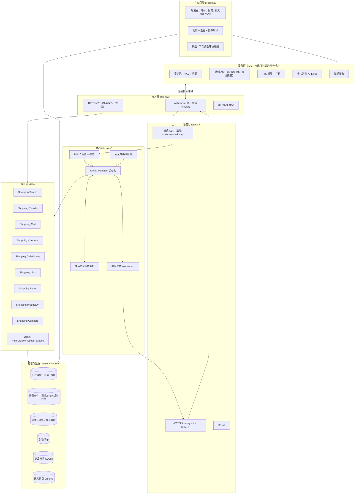

# 架构 v2 · 语音优先的购物助手（Alexa 范式）

> 状态：已搁置　|　日期：2026-10-13
>
> 方向已调整为「能用的不大改」，当前方案见《架构审计与改造》。本文仅保留作语音方向的参考。
>
> 本文替代《系统设计文档 v1.0》中的 Agent 编排与接口部分。目标：把现在的"带多轮上下文的搜索引擎"重构成一个 **Alexa 范式的语音购物助手**：免提、可打断、会追问、会确认、能主动找用户，并且任何购物能力都以 Skill 形式插拔。

---

## 0. 一句话定义

> 用户对着手机说"帮我再买一次上次那个洗面奶，两瓶"，助手在 1.5 秒内开口回答"上次买的是珂润润浸洁面，两瓶 158 元，用默认地址下单吗？"，用户说"好"，订单生成；三天后助手主动推送"快递已签收"，一个月后主动提醒"洗面奶快用完了，要补货吗"。

这句话里包含了 v1 全部缺失的能力：语音双工、情景记忆（上次买的）、事务确认、主动通知、补货推断。

---

## 1. v1 为什么必须推翻而不是修补

| v1 的做法 | 在语音场景下的问题 |
| --- | --- |
| 路由 LLM 一次性决定 tool，pending 状态靠 4 个散落的标志位 | 语音对话 60% 是追问和确认（"要哪个？""确认下单吗？"），需要显式的槽位填充与确认状态机，不能靠 if 链 |
| SSE 单向流 | 语音需要双工：客户端持续上传音频、服务端随时打断（barge-in）、TTS 分句下发 |
| 回复是一段 JSON 话术给屏幕渲染 | 语音回复必须是"一句能听的话 + 一张可看的卡 + 一句追问 + 是否结束会话"四件套 |
| 没有 Reorder、订单、清单、通知 | 这些恰恰是 Alexa Shopping 的主体功能，占语音购物流量的大头 |
| 记忆只有上一轮 last_hits | 语音里"那个""上次那款""我常买的"全靠情景记忆解析 |
| 一次请求 3~4 次 LLM 串行调用，首响 3~6 秒 | 语音容忍上限约 1.5 秒出第一个音，必须分级模型 + 全链路流式 |

**保留的资产**（直接变成 Skill 的内部实现）：`SearchService` 混合检索、`ProductStore` 事实层、`CartStore`、`comparison` 离线对比索引、`reference/resolve` 指代解析、视觉搜索、composer 的话术 prompt。

**丢弃的部分**：`orchestrator.py` 的调度与关键词 guard、`intent_router.py`、`session.py` 的裸 working_memory、SSE 协议、`memory_extractor.py` 的正则抽取。

---

## 2. 总体架构



分层原则：
- **Speech 层只管声音**，不懂业务。
- **Core 层只管对话**：听懂（NLU）、决定下一步（DM）、说出来（NLG）。它不知道"购物车"是什么。
- **Skill 层只管业务**：每个 Skill 声明自己能听懂哪些意图、需要哪些槽位、哪些动作要确认，然后执行。
- **Memory 层**对 Skill 和 DM 都可见，但写入只通过事件总线，不允许 Skill 直接改画像。

---

## 3. 对话核心：Core

### 3.1 NLU：两段式意图与槽位

```
音频 → ASR 文本（带 n-best 与置信度）
      → ① 快速意图分类（小模型 / 规则 + embedding 最近邻，<150ms）
      → ② 对命中 Skill 的槽位做 LLM function-calling 抽取（只给该 Skill 的 schema，<600ms）
      → NLUResult(intent, slots{name: SlotValue(value, raw, confidence, resolved_entity)}, alternatives[])
```

- **交互模型按 Skill 声明**（类似 Alexa Interaction Model）：每个 Skill 的 `manifest.yaml` 列出 intents、sample utterances、slot types、required slots 及其追问话术。NLU 第一段的训练集就是所有 manifest 的 utterances 自动汇总，新增 Skill 不改 NLU 代码。
- **槽位类型化**：`PRODUCT_REF`（"那个""第二个""上次买的"）、`QUANTITY`、`PRICE_RANGE`、`BRAND`、`CATEGORY`、`ADDRESS_REF`、`DATE`、`YES_NO`。`PRODUCT_REF` 的解析由焦点栈完成（见 3.3），NLU 只标出它是一个引用。
- **上下文感知**：DM 处于"等待槽位 X"状态时，NLU 以"填槽模式"运行：先尝试把整句解析成 X 的值，失败再做全量意图分类。这替代 v1 的 `pending_cart / pending_detail / pending_compare` 四个标志和 `is_*_selection_reply` 启发式。
- **ASR 纠错**：槽位值与商品库做模糊匹配（"珂润"被识成"科润"），用 n-best 和拼音相似度在实体层修正，而不是让 LLM 猜。

### 3.2 Dialog Manager：显式状态机

```python
@dataclass
class DialogState:
    session_id: str
    user_id: str
    active_skill: str | None          # 当前承接对话的 Skill
    active_intent: str | None
    frame: SlotFrame                  # 槽位帧：每个槽 filled / missing / needs_confirm / confirmed
    pending_act: DialogAct | None     # 系统上一轮发出的动作：ElicitSlot(x) / ConfirmSlot(x) / ConfirmIntent / Offer(...)
    focus: FocusStack                 # 实体焦点栈（见 3.3）
    turn: int
    last_response: Response           # 供 "再说一遍"
    expires_at: datetime              # 语音会话 8s 无输入则结束，follow-up mode
```

每轮 DM 的决策顺序：

1. **内建意图优先**：Stop / Cancel / Repeat / Help 在任何状态下直接处理。
2. **消费 pending_act**：若上一轮是 ElicitSlot(quantity)，本轮 NLU 填槽模式给出值 → 写入 frame，不重新路由。若上一轮是 ConfirmIntent 且本轮是 YES → 执行；NO → 回退或追问改哪里。
3. **Skill 切换判定**：本轮意图属于另一个 Skill 且置信度高 → 把当前 frame 压入"中断栈"，切过去；完成后询问是否继续之前的事（"刚才那个下单还要继续吗？"）。
4. **委托 Skill**：`skill.handle(intent, frame, context) -> SkillResult`。Skill 返回的不是最终话术，而是**对话动作**：
   - `Elicit(slot, prompt)`：缺槽，请 DM 追问
   - `Confirm(summary, on_yes, on_no)`：事务前确认
   - `Deliver(speech, card, reprompt, end_session)`：给出结果
   - `Offer(next_intent, prompt)`：主动建议下一步（"要加入购物车吗？"）
5. **策略层拦截**：Checkout / 改地址 / 改支付 等事务动作必须经过 `Policy`：确认话术 + 可选语音口令 + 单笔限额。Skill 无法绕过。
6. **NLG 渲染**：把 DialogAct 变成 `Response`。

### 3.3 焦点栈与指代解析

替代 v1 的 `last_hits` 单槽记忆。

```
FocusStack = [FocusEntity(kind=product|order|list|address, id, title, source=search#3|detail|cart|order, turn, salience)]
```

- 每轮 Skill 产出或触及的实体都压栈（搜索结果 5 个、详情 1 个、购物车行若干），带来源与轮次。
- `PRODUCT_REF` 解析规则：序号（"第二个"）在最近一次**列表**内解析；指示词（"这个""它"）取栈顶单实体；名称/品牌做模糊匹配后取 salience 最高；"上次买的 X" 走情景记忆（订单表）而不是栈。
- 对比、详情、加购都**不覆盖**栈，只追加。栈按会话保留，超过 30 个实体淘汰最旧。

### 3.4 NLG：语音优先的四件套响应

```python
@dataclass
class Response:
    speech: str            # 要念出来的话，≤ 2 句，SSML 允许停顿/强调
    card: Card | None      # 屏幕卡片：商品列表 / 订单 / 对比表 / 确认单
    reprompt: str | None   # 8 秒无应答时再问一次的话
    end_session: bool      # 是否结束语音会话（事务完成后 True）
    followups: list[str]   # 屏幕上的可点建议（沿用 v1）
```

- 语音部分由 LLM 生成但**受模板约束**：列表类只念"前 2 个 + 总数"（"找到 5 款，前两款是 A 和 B，要听详细的吗？"），绝不念 5 个商品名 + 价格。
- 事实字段（价格、数量、地址）由代码填模板，不进 LLM。
- 流式：LLM 按句输出 → 每句立刻送 TTS → 音频分片下发；用户开口即打断（barge-in），服务端取消剩余 TTS 与 LLM 生成。

---

## 4. Skill 框架

### 4.1 Skill 契约

```python
class Skill(Protocol):
    manifest: SkillManifest        # 从 skills/<name>/manifest.yaml 加载
    def can_handle(self, nlu: NLUResult, state: DialogState) -> float: ...   # 0~1，DM 用于竞争仲裁
    def handle(self, intent: str, frame: SlotFrame, ctx: SkillContext) -> SkillResult: ...
    def on_resume(self, state: DialogState) -> SkillResult | None: ...       # 被中断后恢复
```

`SkillContext` 提供：用户画像（只读）、焦点栈、情景记忆查询、商品/订单 store、事件发布器（写记忆只能发事件）。

`manifest.yaml` 示例（Reorder）：

```yaml
name: Shopping.Reorder
intents:
  - name: ReorderIntent
    utterances: ["再买一次{product}", "把上次的{product}再来{quantity}", "补货{product}"]
    slots:
      product:  {type: PRODUCT_REF, required: true,  elicit: "想再买哪一件？"}
      quantity: {type: QUANTITY,    required: false, default: 1}
    confirm: true           # 执行前必须确认
  - name: RepeatLastOrderIntent
    utterances: ["把上一单再下一遍"]
    confirm: true
```

### 4.2 Skill 清单（v2 范围）

| Skill | 意图 | 关键槽位 | 事务 | 复用 v1 |
| --- | --- | --- | --- | --- |
| Shopping.Search | 搜索/推荐/细化/换品类/搭配/图搜 | category, price_range, brand, soft_terms | 否 | SearchService、contextual_search、decomposer、visual |
| Shopping.ProductQA | 问详情/评价/差评/尺码 | product_ref, aspect | 否 | product_detail 证据检索 |
| Shopping.Compare | 对比两款 | product_ref×2, focus | 否 | comparison 索引 |
| Shopping.Cart | 加购/改数/删除/查看 | product_ref, sku_options, quantity | 加购需弱确认（念出规格） | CartStore |
| Shopping.Checkout | 下单/结算 | address_ref, payment_ref | **强确认** + 口令/限额 | 新增 orders 表 |
| Shopping.Reorder | 再买一次/补货/重下上一单 | product_ref(历史), quantity | 强确认 | 新增，依赖订单与情景记忆 |
| Shopping.OrderStatus | 我的快递到哪了/退货 | order_ref | 否 | 新增，先接模拟物流 |
| Shopping.Lists | 加到购物清单/念清单/删 | list_name, item | 否 | 新增 |
| Shopping.Deals | 降价提醒我/今天有什么优惠 | product_ref, threshold | 否（创建触发器） | 新增，接 Proactive |
| Builtin | Help/Stop/Cancel/Repeat/Fallback/Yes/No | — | — | 新增 |

扩展性验证：加一个非购物 Skill（如 `Util.Reminder`"提醒我明天买菜"）只需新增一个目录和 manifest，不改 Core。

### 4.3 搜索 Skill 内部（保留并升级 v1 的检索）

```
query + frame → ParsedQuery（沿用 llm_parser）
  → 候选召回：SQL 预筛（品类/价格/品牌）+ 商品级向量召回
  → 证据拉取：入围商品的 chunk 做 rerank
  → 打分：rerank_max + rerank_mean_top3 + 评分 + 价格贴合 + 画像匹配 − 负面证据
  → 约束放宽：零命中时按 软偏好→预算+20%→品牌 逐级放宽并记录放宽项
  → 多样性配额（沿用）
  → SkillResult.Deliver(speech=前两款+总数+放宽说明, card=列表, reprompt="要听第三款吗？")
```

差评极性只做风险提示不参与正向 pooling；每款附 top1 证据原文给 NLG 引用。

---

## 5. 记忆层

### 5.1 三种记忆

| 类型 | 内容 | 写入方式 | 用法 |
| --- | --- | --- | --- |
| 显式画像 | 预算、品牌好恶、肤质、尺码、默认地址、默认支付 | 用户明说（NLU 的 `SetPreferenceIntent`）或设置页 | 硬约束 / 填槽默认值，可撤销 |
| 推断画像 | 预算档位、常买品类、品牌倾向、补货周期 | 离线任务从情景事件与 ParsedQuery 历史统计，带置信度与时间衰减 | **只做排序加权和主动触发**，绝不做硬过滤；话术要说出来源 |
| 情景事件 | search / view_detail / compare / add_cart / remove / order / deliver / reject / price_watch | Skill 通过事件总线发布，`memory/` 消费落库 | 指代解析（"上次那款"）、Reorder、补货周期、Deals |

### 5.2 表

```
user_profile(user_id, explicit_json, inferred_json, updated_at)
user_events(id, user_id, session_id, type, product_id, order_id, payload_json, ts)
orders(order_id, user_id, status, total, address_json, created_at)
order_lines(order_id, sku_id, product_id, qty, price)
shopping_lists(list_id, user_id, name) / list_items(list_id, text, product_id, done)
price_watches(id, user_id, product_id, threshold, created_at, fired_at)
```

### 5.3 会话记忆

`DialogState` 整体序列化存储（替代 `agent_sessions`）。跨会话的"follow-up"：新会话开始时加载同用户最近 24 小时的焦点栈顶 3 个实体，让"刚才看的那个"跨 App 冷启动仍可解析。

---

## 6. 主动引擎

```
触发器 → 候选通知 → 策略过滤（静默时段 / 频次上限 / 用户开关）→ 投递
```

| 触发器 | 数据来源 | 话术 |
| --- | --- | --- |
| 物流状态变化 | orders.status（先用模拟器推进） | "你的珂润洁面已签收" |
| 降价到阈值 | price_watches × 商品价格表 | "你关注的耳机降到 299 了，要下单吗？" |
| 补货周期到期 | 推断画像的 replenish_interval | "洗面奶大约该补货了，上次是 8 月 12 日买的" |
| 定时清单提醒 | shopping_lists + Util.Reminder | "你清单上还有 3 样没买" |

投递两条路：APNs 推送（App 在后台）；或在下一次语音会话开场先播报（"在开始前，你有一条物流更新"），用户可说"跳过"。

---

## 7. 接入协议：WebSocket 双工

`/v2/voice` 一条连接承载一个语音会话：

客户端 → 服务端：
```
{type:"session.start", user_id, device, locale, text_mode:false}
{type:"audio", seq, pcm16_base64}            # 20ms 帧
{type:"audio.end"}                            # VAD 判定说完
{type:"barge_in"}                             # 用户在 TTS 播放中开口
{type:"text", content}                        # 文本模式（屏幕输入，走同一条链）
{type:"card.action", action, payload}         # 屏幕点击（加购按钮等）走同一 DM
```

服务端 → 客户端：
```
{type:"asr.partial", text}  {type:"asr.final", text, confidence}
{type:"state", skill, act}                    # 调试/UI 胶囊："正在查订单"
{type:"speech.sentence", idx, text}           # 分句文本（字幕）
{type:"audio", idx, seq, opus_base64}         # 对应句子的 TTS 音频
{type:"card", card}
{type:"turn.end", end_session, reprompt_in_ms}
{type:"error", code, message}
```

REST 保留给设置、历史、偏好编辑；所有"用户表达的意图"无论语音、文本、点击，都进同一个 DM，保证状态一致。

---

## 8. 模型与延迟预算

目标：说完到听到第一个音 ≤ 1.5 s（P50），≤ 2.5 s（P95）。

| 阶段 | 预算 | 手段 |
| --- | --- | --- |
| ASR 尾延迟 | 300 ms | 流式识别，VAD 判停即出 final |
| 意图分类 | 150 ms | 规则 + utterance embedding 最近邻（本地），不调大模型 |
| 槽位抽取 | 600 ms | 小而快的模型（qwen-turbo 档）function calling，只给当前 Skill 的 schema |
| Skill 执行 | 300 ms | 检索走热缓存；事务走 SQLite |
| NLG 首句 | 400 ms | 首句用模板直出（"找到 5 款"），LLM 续写后面；流式 |
| TTS 首包 | 300 ms | 流式 TTS，分句送 |

分级模型：分类用本地 / 小模型，抽槽用 turbo 档，只有 NLG 和 ProductQA 用 flash/plus 档。所有调用经统一网关记录 token、延迟、fallback。

---

## 9. 安全与事务策略

- 事务意图（下单、改地址、改支付、删清单）由 `Policy` 统一要求 `Confirm`，确认话术必须复述金额、数量、地址。
- 语音下单可选 4 位口令（画像里设置），单笔超过限额强制口令。
- 否定与澄清优先：ASR 置信度低于阈值时先复述确认（"你是说珂润吗？"），不直接执行。
- 任何 Skill 抛错 → DM 给出可恢复的话术并保留 frame（"刚才下单没成功，要再试一次吗？"），不丢用户已填的槽。

---

## 10. 目录结构

```
backend/
  gateway/        ws_server.py, rest.py, auth.py, protocol.py
  speech/         asr.py, tts.py, vad.py, earcons/
  core/           nlu/ (classifier.py, slot_filler.py, entity_resolver.py)
                  dialog/ (state.py, manager.py, acts.py, focus.py, policy.py)
                  nlg/ (renderer.py, templates/, prompts/)
  skills/         base.py, registry.py
                  shopping_search/ (manifest.yaml, skill.py, ranking.py, relax.py)
                  shopping_reorder/ shopping_cart/ shopping_checkout/ shopping_order_status/
                  shopping_lists/ shopping_deals/ shopping_product_qa/ shopping_compare/
                  builtin/
  memory/         profile.py, episodic.py, inference_jobs.py, events.py
  proactive/      triggers/, scheduler.py, delivery.py
  store/          （沿用：product_store, cart_store；新增 orders, lists, watches）
  search/ rag/    （沿用，作为 shopping_search 的依赖）
  llm/            gateway.py（统一调用 + 观测）, providers/
  evals/          nlu_cases.jsonl, dialog_scripts.yaml, runner.py
client/           VoiceSession（WS）、AudioPipeline（VAD/录音/播放/打断）、CardRenderer
```

---

## 11. 分阶段落地

**阶段 1：对话核心替换（文本模式先行）**
- 实现 DialogState / SlotFrame / DialogAct / FocusStack / Policy。
- Skill 框架 + registry；把 v1 的 recommend / refine / compare / detail / cart 迁成 5 个 Skill，行为与 v1 对齐。
- Builtin Skill（Yes/No/Cancel/Repeat/Help）。
- WebSocket 协议上线，文本模式走新链路；SSE 保留一个版本周期做回归对照。
- 验收：v1 的 256 个单测迁移后仍绿；新增对话脚本评测（多轮 yaml）。

**阶段 2：语音双工**
- 云端流式 ASR + 流式 TTS + 分句 + barge-in。
- NLG 改为四件套响应，语音模板约束。
- iOS：AudioPipeline、免提模式、字幕、卡片。
- 验收：首音 P50 ≤ 1.5 s；ASR 低置信度复述确认率。

**阶段 3：事务与记忆**
- orders / order_lines / user_events / lists / price_watches 表。
- Checkout（强确认 + 口令）、Reorder、OrderStatus（模拟物流）、Lists。
- 情景记忆驱动的指代（"上次买的"）；推断画像离线任务；排序接入画像加权与约束放宽。

**阶段 4：主动与规模**
- Proactive 引擎 + APNs + 会话开场播报。
- Deals / 补货提醒。
- 商品库扩到数千 SKU（Amazon 数据），检索改两段式。

---

## 12. 与 v1 的决策对照

| 维度 | v1 | v2 |
| --- | --- | --- |
| 对话控制 | 路由 LLM + if 链 + 4 个 pending 标志 | 显式状态机：槽位帧 + 对话动作 + 焦点栈 + 中断栈 |
| 能力组织 | 7 个 tool 写死在 KNOWN_TOOLS | Skill manifest 声明式注册，NLU 自动汇总 |
| 指代 | last_hits 单槽，会被覆盖 | 焦点栈 + 情景记忆 |
| 响应 | JSON 话术给屏幕 | speech + card + reprompt + end_session |
| 传输 | SSE 单向 | WebSocket 双工，支持打断 |
| 记忆 | 正则抽偏好 | 显式 / 推断 / 情景三层，事件驱动写入 |
| 事务 | 无确认、无订单 | Policy 强制确认、口令、限额、订单表 |
| 主动性 | 无 | 触发器 + 调度 + 推送 |
| 模型使用 | 同一模型串行 3~4 次 | 分级模型，分类本地化，全链路流式 |
